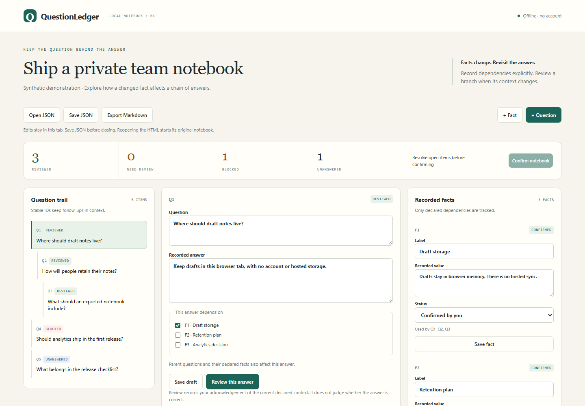

# QuestionLedger

**Keep the question behind the answer. Revisit it when the facts change.**

A planning session starts with “Which storage should we use?” and ends five follow-ups later. QuestionLedger keeps those questions together, gives each a stable ID, and marks answers for review when their recorded context changes.

Change a fact used by **Q1**: its answer needs review, its follow-ups are blocked, and unrelated questions stay reviewed.

[Download the offline notebook](https://github.com/4onv/questionledger/releases/download/v0.1.0/questionledger.html) · [Release files](https://github.com/4onv/questionledger/releases/tag/v0.1.0) · [JSON format](docs/format.md) · [Research and alternatives](docs/research-2026-11-08.md)

*The screenshot and bundled example use synthetic demonstration data.*

## Try it in a minute

1. Download [questionledger.html](https://github.com/4onv/questionledger/releases/download/v0.1.0/questionledger.html) and open it in a current Chromium or Firefox browser.
2. In the example, change **F1**, then click **Save fact**.
3. **Q1** changes from Reviewed to Needs review. Its descendants **Q2** and **Q3** become Blocked. Select them to see their parent questions and answers.
4. Review Q1 against the new fact, then work down the branch. Each affected answer still needs its own review.

No installation, account, model, API key or server is required for the HTML notebook. It contains its own code and styles and makes no network requests.

The initial example has three reviewed questions, one question blocked by a pending fact, and one unanswered question. It deliberately starts unfinished.

**Keep your work:** use **Save draft**, **Review this answer** or **Save fact** to apply form edits, then **Save JSON** to download the notebook. Unapplied form edits stay available when you switch questions; exports, imports and confirmation wait until those edits are saved. Everything stays in the current tab; there is no disk autosave. Reopening the original HTML restores its embedded example. Use **Open JSON** to continue from a saved file.

## What it does

- Keeps follow-up questions attached to their parents, with stable IDs and visible original context.
- Records facts as pending or confirmed by you, with explicit question-to-fact dependencies.
- Preserves draft answers while their dependencies are unresolved.
- Detects changes to question wording, answer text, parent context and declared facts using deterministic fingerprints.
- Separates unanswered, blocked, needs-review and reviewed states.
- Exports editable JSON and a readable Markdown handoff with IDs, statuses and dependency references.
- Builds a self-contained HTML notebook from your JSON and checks it from the command line.

A child inherits its ancestors' declared facts. It cannot be reviewed until every ancestor is reviewed and every relevant fact is confirmed. A notebook becomes ready only when it contains at least one question, all questions are reviewed, and **all** recorded facts are confirmed—even unused facts.

**Confirm notebook** records an acknowledgement of that exact notebook content. This is a local state marker: it does not identify an approver, verify truth, or authorize an agent to act.

## Install the CLI from a release

Requires **Node.js 22 or newer**. Download [4onv-questionledger-0.1.0.tgz](https://github.com/4onv/questionledger/releases/download/v0.1.0/4onv-questionledger-0.1.0.tgz), then run:

~~~sh
npm install --global --offline --ignore-scripts ./4onv-questionledger-0.1.0.tgz
questionledger demo --out demo.html
~~~

Open the generated `demo.html` in your browser. The release archive has no runtime package dependencies. This project is distributed through GitHub releases; these commands do not require an npm registry release.

To start your own notebook:

~~~sh
questionledger init --out notebook.json
questionledger build notebook.json --out notebook.html
~~~

Open `notebook.html`, add your questions and facts, and save the edited JSON. You can then inspect or export the saved file:

~~~sh
questionledger check questionledger.json
questionledger check questionledger.json --json
questionledger markdown questionledger.json --out handoff.md
questionledger build questionledger.json --out updated-notebook.html
~~~

Every output path must be new. The CLI refuses to overwrite an existing file.

| Command | Result |
| --- | --- |
| `init --out FILE.json` | One unanswered starter question |
| `demo --out FILE.html` | Interactive synthetic example |
| `build INPUT.json --out FILE.html` | Self-contained editable notebook |
| `check INPUT.json [--json]` | Readiness, counts, reasons and fingerprints |
| `markdown INPUT.json --out FILE.md` | Readable snapshot for a handoff or repository |

`check` exits **0** when the notebook is structurally ready, **1** when review work remains, and **2** for invalid input or an operational error. Exit 0 does **not** require the separate notebook confirmation.

## Use it from source

~~~sh
git clone https://github.com/4onv/questionledger.git
cd questionledger
node bin/questionledger.js demo --out demo.html
~~~

No dependency installation is needed to run the CLI from source.

The portable core is also available through `@4onv/questionledger/core` when the archive is installed in your project. It exports validation, analysis, draft/review/fact updates, confirmation and Markdown conversion. All mutations return independent data. See the [API and schema reference](docs/format.md).

## Where it fits

Use it for design discussions, requirements interviews, planning with an agent, and handoffs where “we already answered that” depends on what was known at the time.

Existing tools already cover much of this territory:

| Tool | Established capability | QuestionLedger's narrower focus |
| --- | --- | --- |
| [Code Recall](https://github.com/erikhuang76821/code-recall) | Local decision and lesson ledgers, lifecycle and agent context hooks | Active question rounds and explicit dependency changes |
| [Plan Tree](https://github.com/SeemSeam/plan-tree) | Durable planning trees, stable IDs, open questions and evidence | A small editable browser notebook |
| [Scrutable](https://github.com/MSKazemi/scrutable) | Questions, evidence, dependencies, reopening rules and structural validation | A focused interactive workflow, without its broader assurance framework |
| [Log4brains](https://github.com/thomvaill/log4brains) / [ADR Tools](https://github.com/npryce/adr-tools) | Architecture decision records and their lifecycle | Questions that are still being resolved |
| [adr-skills](https://github.com/wooxogh/adr-mcp-setup) | Conversation-derived ADRs, dependency links and stale alerts | Explicit local input and deterministic context checks |

QuestionLedger does not invent decision ledgers, question trees or evidence-driven review. Its contribution is a compact, immediately runnable combination of those ideas. The [dated research note](docs/research-2026-11-08.md) describes the reports that motivated it and the alternatives considered.

## Limits

- Dependencies must be declared. A missing dependency stays invisible.
- “Confirmed fact” means confirmed by the person editing the notebook. The tool does not investigate it.
- Fingerprints detect changed recorded content, not semantic contradictions, historical events or malicious edits. They are not signatures.
- There is no chat import, agent hook, automatic conversation extraction, collaboration service or version history.
- Changes are kept in memory until you save JSON. The browser UI does not delete, reparent or rename existing IDs; edit the JSON for structural changes.
- Imported notebooks are limited to 100 questions, 50 facts, 20 levels of ancestry and 512 KiB of canonical JSON. The input file limit is 1 MiB. [Text limits and validation rules](docs/format.md#limits) are documented.
- A generated HTML file includes the notebook data inside it. Share it only with people who should receive those contents.

## Development

~~~sh
npm ci
npm test
npx playwright install chromium firefox
npm run demo
npm run test:browser
npm pack --ignore-scripts
npm run check:package
~~~

The tests cover dependency propagation, changed answers, confirmation binding, strict JSON parsing, output handling, browser interactions and package use. Browser tooling is development-only.

MIT licensed. [Issues](https://github.com/4onv/questionledger/issues) with a small synthetic reproduction are welcome.
